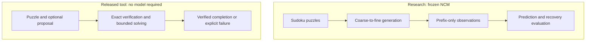

<h1 align="center">Concept Firewall</h1>

<p align="center"><strong>Studying Model Errors. Shipping Verified Sudoku Tooling.</strong></p>

<p align="center">
  <a href="https://github.com/yoonalexander/Concept-Firewall/releases/tag/cli-v0.2.0"></a>
  <a href="CLI_README.md"></a>
  <a href="https://github.com/yoonalexander/Concept-Firewall/actions/workflows/cli-release.yml"></a>
  <a href="results/reports/recoverability_analysis.md"></a>
</p>

<p align="center">
  <a href="#highlights">Highlights</a> &bull;
  <a href="#results">Results</a> &bull;
  <a href="#installation">Installation</a> &bull;
  <a href="#reproducibility">Reproducibility</a>
</p>

Concept Firewall investigates whether signals inside a frozen [Next-Concept Modeling (NCM)](https://github.com/HazyResearch/ncm) hierarchy can predict eventual Sudoku errors and help allocate recovery compute. The project combines reproducible experiments, decision-time feature capture, exact verification, and comparisons against cheap baselines.

The repository also ships a **dependency-free Sudoku CLI**: verify a proposed answer, preserve it if valid, or solve the original puzzle with bounded exact search.



> **Research outcome:** the tested learned policies did not demonstrate a useful recovery-allocation advantage after costs. The studies are closed. The released exact solver is a classical engineering fallback; it does not establish learned intervention or general AI safety effectiveness.

## Highlights

### Observe the generation hierarchy

The research pipeline reproduced the official hard-Sudoku evaluator, collected **24,000 corrected full-prefix records** across 2,000 puzzles, and checked every final reconstruction against the baseline. Subsequent experiments captured generator confidence and activations at a fixed decision boundary before future generation. Immutable prefix observations, grouped partitions, frozen protocols, and independent constraint checks keep the measurements auditable.

<p align="center">
  
</p>

<p align="center"><em>Initial representation study: the prespecified level-6 latent addition did not improve prediction. Bands are pointwise; later confidence and recovery studies are reported separately below.</em></p>

### Test whether warnings help recovery

A fixed confidence warning identified failures with **88.97% alert precision** and **23.96% failure recall** on 1,600 project-held-out puzzles. Predictive information alone did not establish recovery value, so later experiments compared actual retry outcomes and charged monitoring costs.

The final recoverability analysis reused that now-exposed cohort. At **272 retries**, its primary model produced:

| Retry method | Learned recovery ranking | Verifier-first random expectation | Cheap low-entropy ranking |
|---|---:|---:|---:|
| Fixed-prefix continuation | 20 rescues | 16.97 rescues | 24 rescues |
| Full stochastic restart | 30 rescues | 28.28 rescues | 38 rescues |

Both primary 97.5% gain intervals include zero. After monitoring costs, the primary gains shrink to **+0.23 and −4.31 rescues**. The entropy control remains exploratory and uncertain after costs. **Decision: inconclusive evidence; no-go for advancing the learned allocator.** See the [full analysis](results/reports/recoverability_analysis.md) for controls, uncertainty, timing assumptions, and limitations.

### Return verified Sudoku answers

The standalone CLI uses only Python's standard library. It checks every clue, row, column, and box; preserves valid proposals without search; and uses deterministic minimum-remaining-values backtracking when a proposal fails verification.

On **6,400 already exposed development puzzles**, it preserved 2,479 valid model answers and completed the remaining 3,921 with exact search. Every resulting board passed an independent verifier. This is exact-solver development validation, **not neural-model accuracy or a guarantee for arbitrary inputs**. Invalid, unsatisfiable, and search-budget-exhausted inputs receive explicit failure results. [Fallback evaluation →](results/reports/verified_sudoku_fallback.md)

## Results

| Study | Recorded result | Evidence |
|---|---|---|
| Official hard-Sudoku reproduction | 1,725/2,000 solved (86.25%); final outputs matched the official evaluator | [Baseline report](results/reports/baseline_reproduction.md) |
| Initial representation probes | Level-6 latent addition: −0.0078 AUROC, 95% interval [−0.0368, +0.0193] | [Probe evaluation](results/reports/probe_evaluation.md) |
| V2 generator signals | Neither candidate met the frozen practical detector gate | [V2 report](results/reports/v2_detector_study.md) |
| Separate fixed-warning confirmation | 242 failures among 272 alerts; 1,600 puzzles | [Confirmation report](results/reports/confidence_allocation_confirmation.md) |
| Confidence-guided retries | Neither tested retry method established the required benefit over verifier-first allocation | [Recovery comparison](results/reports/confidence_allocation_recovery.md) |
| Saved-data recoverability analysis | Primary learned allocator failed the frozen advancement criteria | [Final analysis](results/reports/recoverability_analysis.md) |
| Practical exact fallback | 6,400/6,400 development completions independently verified | [Fallback report](results/reports/verified_sudoku_fallback.md) |

These studies use different cohorts and answer different questions; their accuracy figures are not interchangeable. The original detector gate remains failed. All later analysis cohorts are exposed, and cross-validation does not restore fresh confirmation. The [reconstruction correction](results/reports/reconstruction_correction.md) identifies superseded early runs; only corrected full-prefix results should be cited.

## Released tool

| Delivery | Contents | Links |
|---|---|---|
| **CLI 0.2.0** | Wheel, source distribution, installation guide, release notes, verification reports, and SHA-256 checksums | [Download](https://github.com/yoonalexander/Concept-Firewall/releases/tag/cli-v0.2.0) · [CLI guide](CLI_README.md) · [Delivery record](release/0.2.0/README.md) |
| Historical study 0.1.1 | Frozen research snapshot and reproduction instructions | [Source tag](https://github.com/yoonalexander/Concept-Firewall/tree/sudoku-study-v0.1.1) · [Study notes](RELEASE_NOTES.md) |

Release verification passed **128 tests and 133 subtests**, **328 installed-command checks** across four clean offline installations, and six Windows/Linux CI jobs on Python 3.10, 3.12, and 3.14. Independent no-fit audits rechecked 11,200 retained outcomes and 60 recoverability allocation/budget comparisons. [Integration evidence →](release/0.2.0/integration-verification.json)

## Installation

Use **Python 3.10+** in an activated virtual environment. Download the wheel and `SHA256SUMS` from the [CLI release](https://github.com/yoonalexander/Concept-Firewall/releases/tag/cli-v0.2.0), verify the checksum, then install:

```console
python -m pip install --no-index ./concept_firewall-0.2.0-py3-none-any.whl
python -m concept_firewall --version
```

`verify` and `solve` need no Torch, CUDA, checkpoints, datasets, network access, or upstream submodule. Full platform-specific installation steps and source-distribution instructions are in [CLI_README.md](CLI_README.md).

## Use

Solve a puzzle from its original clues:

```console
python -m concept_firewall solve --puzzle 530070000600195000098000060800060003400803001700020006060000280000419005000080079
```

Verify a proposed completion:

```console
python -m concept_firewall verify --puzzle 530070000600195000098000060800060003400803001700020006060000280000419005000080079 --board 534678912672195348198342567859761423426853791713924856961537284287419635345286179
```

Add `--board` to `solve` to check a proposal before falling back to exact search. `--node-limit` sets a positive search-node budget; the default is 100,000 nodes, not a wall-clock timeout or uniqueness proof. Commands emit structured JSON and exit `0` for verified success, `1` for invalid/unresolved outcomes, or `2` for usage/configuration errors.

After installation, run the [demo](examples/sudoku_demo.py) from a repository checkout or extracted source distribution:

```console
python examples/sudoku_demo.py
```

The demo rejects an invalid proposal, solves the original puzzle, and rechecks the completion through the installed CLI. See the [command reference](CLI_README.md#json-output-and-exit-codes) for input formats and output fields.

## Reproducibility

Run manifests preserve commands, source snapshots, dependency versions, artifact hashes, parameters, and resource accounting. Large raw evidence and checkpoints are excluded from ordinary Git; their inventories and restoration instructions are retained.

| Evidence | Reproduction guide |
|---|---|
| Original NCM/Sudoku study and historical package | [Reproduce the study](docs/reproduce_study.md) |
| Confidence allocation, retry outcomes, and exact fallback | [Restore and audit retained evidence](docs/reproduce_confidence_allocation.md) |
| Final saved-data recoverability analysis | [Replay the no-fit audit](docs/reproduce_recoverability_analysis.md) |
| Standalone wheel and source distribution | [Build and verify the CLI](docs/cli_release.md) |

The consumed scientific runs intentionally refuse repeated attempts. Follow the retained-data audit guides to inspect results without fitting or generating new model outputs. Historical ledgers and failed gates remain preserved.

<details>
<summary><strong>Optional research environment</strong></summary>

The standalone CLI does not require this setup. To inspect research code in a checkout, initialize the pinned upstream source and install the optional dependencies in a separate virtual environment:

```console
git clone https://github.com/yoonalexander/Concept-Firewall.git
cd Concept-Firewall
git submodule update --init third_party/ncm
python -m pip install -e ".[research,test]"
python -m concept_firewall doctor
```

Historical model execution used Python 3.12 and a CUDA-capable PyTorch build. Device-specific setup and official artifact restoration are covered in the linked study guides. Installing dependencies does not authorize reopening a consumed experiment.

</details>

## Repository layout

- `src/concept_firewall/` — CLI, exact verifier/solver, observational wrappers, and research analysis.
- `examples/` — runnable installed-command demo.
- `configs/` — frozen experimental specifications and evaluator settings.
- `tests/` — verifier, solver, leakage, grouping, resource-guard, and integration checks.
- `scripts/` — distribution checks and retained-evidence audits.
- `results/` — reports, figures, manifests, metrics, and evidence inventories.
- `docs/` — protocols, limitations, design review, and reproduction guides.
- `third_party/ncm/` — unmodified upstream source pinned to `c70274273f489abc73832b2b98584a8483b6b203`.

## Design and acknowledgements

The [original design](Concept_Firewall_Design_Document.md) records the research vision; the [design review](docs/design_review.md) and [limitations](docs/limitations.md) explain its evidence boundaries. The [original roadmap](ROADMAP.md), [V2 roadmap](ROADMAP_V2.md), and [completed allocation follow-on](ROADMAP_CONFIDENCE_ALLOCATION.md) preserve the scoped decisions. Broader learned intervention and natural-language phases were not completed.

This project builds on [HazyResearch's Next-Concept Modeling](https://github.com/HazyResearch/ncm), using the reviewed official tokenizer/generator checkpoints and the pinned upstream implementation. New-source Sudoku puzzles came from the [Sudoku Exchange puzzle bank](https://github.com/grantm/sudoku-exchange-puzzle-bank). See [THIRD_PARTY_NOTICES.md](THIRD_PARTY_NOTICES.md) for source/data attribution and licensing; the CLI release does not add a project-wide license grant.
