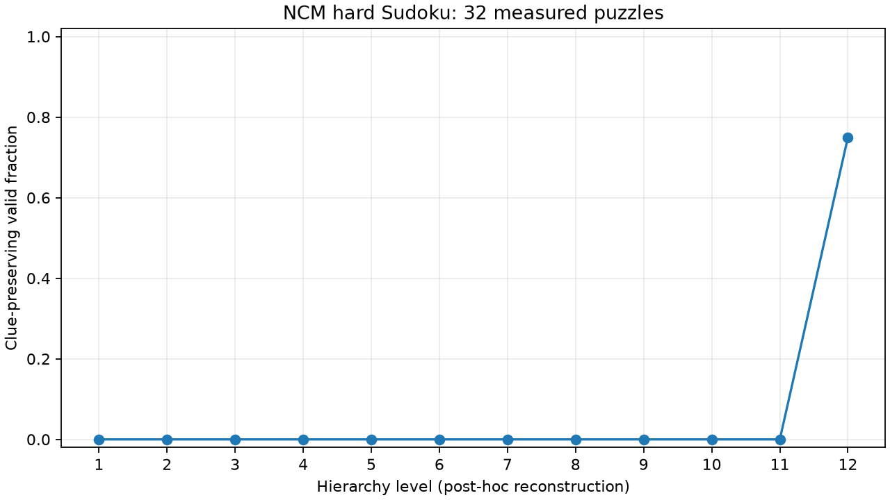

> **Superseded:** Uses native short z_levels, not full candidate boards. See [reconstruction correction](reconstruction_correction.md). Do not use for the intended intermediate-board/probe comparison.

# Measured trajectory analysis

Run: `20261021T014240800481Z-collection`. Manifest: `results\manifests\20261021T014240800481Z-collection.json` (SHA-256 `7515c74ed8166ca3dcea3921d9eef28d0710b0d71580fbf171149eb16970fc7f`). Source snapshot hash: `5f443a1b8384628aaef47b324d11cfc65e424b8c1e1c9719251c5bf1c66f2065`.

Observed 32 trajectories / 32 unique puzzles, each with 12 levels. Final clue-preserving valid completions: 24/32. Every final output matches the official baseline.

These are full-depth, post-hoc observations. No per-level generator timing, live lead time, intervention benefit or speedup was measured. A smoke subset does not establish statistical probe performance.

| Level | Unique puzzles | Current correct | Malformed |
|---:|---:|---:|---:|
| 1 | 32 | 0/32 | 32 |
| 2 | 32 | 0/32 | 32 |
| 3 | 32 | 0/32 | 32 |
| 4 | 32 | 0/32 | 32 |
| 5 | 32 | 0/32 | 32 |
| 6 | 32 | 0/32 | 32 |
| 7 | 32 | 0/32 | 32 |
| 8 | 32 | 0/32 | 32 |
| 9 | 32 | 0/32 | 32 |
| 10 | 32 | 0/32 | 32 |
| 11 | 32 | 0/32 | 32 |
| 12 | 32 | 24/32 | 0 |

Trajectory categories (exhaustive, mutually exclusive):

- repaired_by_final_level: 24
- wrong_at_every_level: 8

| Transition | Wrong → wrong | Wrong → right | Right → wrong | Right → right |
|---|---:|---:|---:|---:|
| 1 → 2 | 32 | 0 | 0 | 0 |
| 2 → 3 | 32 | 0 | 0 | 0 |
| 3 → 4 | 32 | 0 | 0 | 0 |
| 4 → 5 | 32 | 0 | 0 | 0 |
| 5 → 6 | 32 | 0 | 0 | 0 |
| 6 → 7 | 32 | 0 | 0 | 0 |
| 7 → 8 | 32 | 0 | 0 | 0 |
| 8 → 9 | 32 | 0 | 0 | 0 |
| 9 → 10 | 32 | 0 | 0 | 0 |
| 10 → 11 | 32 | 0 | 0 | 0 |
| 11 → 12 | 8 | 24 | 0 | 0 |

Exact baseline command, artifact/data digests, upstream SHA, environment and batch costs are recorded in the linked collection/baseline manifests. Outcomes are eventual correctness labels; current incorrect states may self-correct.
