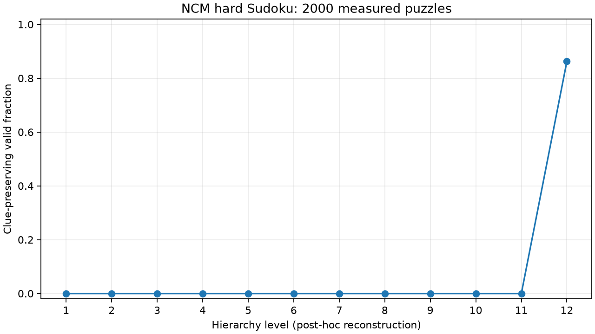

> **Superseded:** Uses native short z_levels, not full candidate boards. See [reconstruction correction](reconstruction_correction.md). Do not use for the intended intermediate-board/probe comparison.

# Measured trajectory analysis

Run: `20261021T014611959101Z-collection`. Manifest: `results\manifests\20261021T014611959101Z-collection.json` (SHA-256 `1428b3f28cdd4b1e9273b0c93666db6bb6f72ac2e45a1b16b4e850f2c059a8fe`). Source snapshot hash: `8bc88feab742cd698e32c8b444b82ec7083a1a86dc0a06eb2cc3df02cb43edad`.

Observed 2000 trajectories / 2000 unique puzzles, each with 12 levels. Final clue-preserving valid completions: 1725/2000. Every final output matches the official baseline.

These are full-depth, post-hoc observations. No per-level generator timing, live lead time, intervention benefit or speedup was measured. A smoke subset does not establish statistical probe performance.

| Level | Unique puzzles | Current correct | Malformed |
|---:|---:|---:|---:|
| 1 | 2000 | 0/2000 | 2000 |
| 2 | 2000 | 0/2000 | 2000 |
| 3 | 2000 | 0/2000 | 2000 |
| 4 | 2000 | 0/2000 | 2000 |
| 5 | 2000 | 0/2000 | 2000 |
| 6 | 2000 | 0/2000 | 2000 |
| 7 | 2000 | 0/2000 | 2000 |
| 8 | 2000 | 0/2000 | 2000 |
| 9 | 2000 | 0/2000 | 2000 |
| 10 | 2000 | 0/2000 | 2000 |
| 11 | 2000 | 0/2000 | 2000 |
| 12 | 2000 | 1725/2000 | 0 |

Trajectory categories (exhaustive, mutually exclusive):

- repaired_by_final_level: 1725
- wrong_at_every_level: 275

| Transition | Wrong → wrong | Wrong → right | Right → wrong | Right → right |
|---|---:|---:|---:|---:|
| 1 → 2 | 2000 | 0 | 0 | 0 |
| 2 → 3 | 2000 | 0 | 0 | 0 |
| 3 → 4 | 2000 | 0 | 0 | 0 |
| 4 → 5 | 2000 | 0 | 0 | 0 |
| 5 → 6 | 2000 | 0 | 0 | 0 |
| 6 → 7 | 2000 | 0 | 0 | 0 |
| 7 → 8 | 2000 | 0 | 0 | 0 |
| 8 → 9 | 2000 | 0 | 0 | 0 |
| 9 → 10 | 2000 | 0 | 0 | 0 |
| 10 → 11 | 2000 | 0 | 0 | 0 |
| 11 → 12 | 275 | 1725 | 0 | 0 |

Exact baseline command, artifact/data digests, upstream SHA, environment and batch costs are recorded in the linked collection/baseline manifests. Outcomes are eventual correctness labels; current incorrect states may self-correct.
