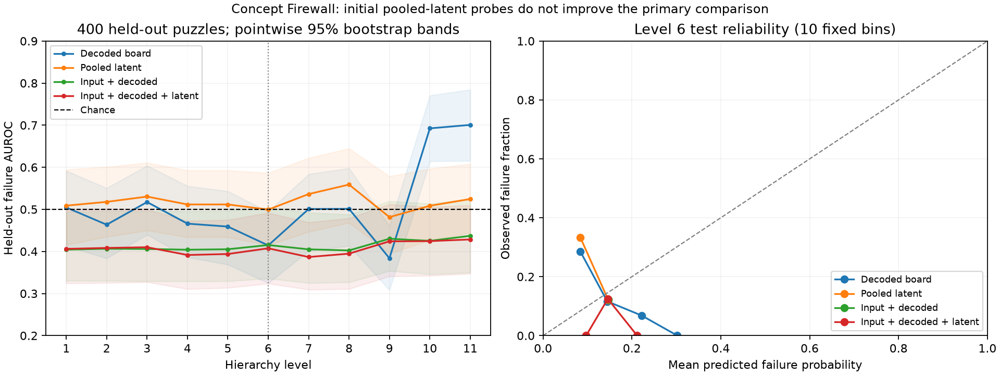

# Initial probe result: no demonstrated latent improvement

The initial M0–M3 research implementation is complete. **The prespecified primary comparison is negative.** At level 6, adding the pooled cumulative latent to the input-plus-decoded control changes held-out failure AUROC by **−0.0078**, with paired puzzle-bootstrap 95% interval **[−0.0368, +0.0193]**. This does not demonstrate useful incremental prediction. It also does not establish that richer NCM representations contain no signal.

| Level 6 model | Test AUROC |
|---|---:|
| Training prevalence / level-only | 0.5000 |
| Raw input grid | 0.4053 |
| Decoded-board features | 0.4143 |
| Pooled cumulative latent | 0.4994 |
| Input + decoded | 0.4152 |
| Input + decoded + latent | 0.4074 |
| Shuffled-training-label latent control | 0.5336 |

The public 2,000-puzzle official test dataset was partitioned by exact clue-grid identity before fitting: 1,000 train (148 failures), 300 validation (34), 300 calibration (44), 400 internal test (49). These internal test results are not an untouched official benchmark. Input grids are categorical one-hot controls; decoded features are current-board diagnostics. Linear probes use the 256-dimensional mean of the full cumulative tokenizer latent. Spatial pooling may remove important correctness information.

All C choices use validation log loss. Scaling and base models fit on training data; sigmoid calibration and empirical 5% false-positive thresholds use calibration data. Some held-out FPRs exceed that calibration target; no population false-alarm guarantee is established. All levels/models are disclosed, including negative and shuffled controls. Secondary comparisons are exploratory without multiplicity adjustment. The final level is diagnostic only.

The decoded-only control reaches AUROC 0.6925 and 0.7007 at levels 10 and 11 respectively; this is an exploratory descriptive finding, not a selected primary success or proof of online value. No latent/intervention benefit, conditional recoverability, speedup, novelty or safety effectiveness has been established.



The left plot excludes post-generation level 12; its bands are pointwise, not simultaneous. Reliability points summarize nonempty fixed test bins and can be noisy. Nothing was refitted for these plots.

Evidence and exact reproduction:

- [Full metrics, confidence intervals and reliability bins](20261021T015457393177Z-probes-probe_evaluation.md)
- [Run manifest, commands, source snapshot and provenance](../manifests/20261021T015457393177Z-probes.json)
- [Frozen puzzle partitions](../manifests/20261021T015457393177Z-probes-splits.json)
- [Saved-probe prediction and training-scaler audit](../manifests/20261021T015457393177Z-probes-artifact_validation.json)
- [Corrected observational analysis](level_trajectory_analysis.md)
- [Initial reconstruction mistake and superseded experiments](reconstruction_correction.md)

```powershell
.\.venv\Scripts\python.exe -m concept_firewall train --manifest results/manifests/20261021T015216719695Z-collection.json --protocol configs/probe_protocol.json
.\.venv\Scripts\python.exe scripts/verify_probe_artifacts.py --manifest results/manifests/20261021T015457393177Z-probes.json
.\.venv\Scripts\python.exe scripts/plot_probe_results.py --manifest results/manifests/20261021T015457393177Z-probes.json
```

**Decision:** retain this negative result and stop at M3. Branching, live policies, natural-language extensions and a viewer remain deferred under the design gates. A future representation study would require a separately declared protocol and appropriate held-out data; these test outcomes should not be repeatedly used to tune the current experiment.
